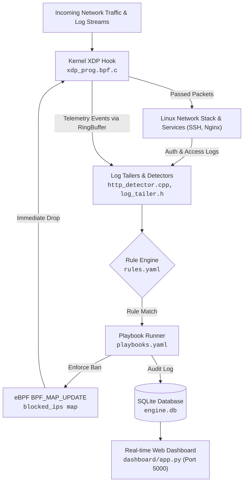

# 🛡️ XDP-Engine: Kernel-Speed Intrusion Mitigation & SOAR

An enterprise-grade, eBPF-powered firewall and Security Orchestration, Automation, and Response (SOAR) engine.  
Filters millions of malicious packets per second in Linux kernel space at driver speed before they reach the OS networking stack, backed by automated log correlation, rule-based playbooks, and a live web telemetry dashboard.


---

## 📌 Table of Contents
1. [Overview & Key Features](#-overview--key-features)
2. [System Architecture](#-system-architecture)
3. [Prerequisites & Dependencies](#-prerequisites--dependencies)
4. [Step-by-Step Setup Guide](#-step-by-step-setup-guide)
   - [Step 1: Clone the Repository](#step-1-clone-the-repository)
   - [Step 2: Build the Engine](#step-2-build-the-engine)
   - [Step 3: Launch the Web Dashboard](#step-3-launch-the-web-dashboard)
   - [Step 4: Launch the XDP Engine](#step-4-launch-the-xdp-engine)
5. [Interactive Console Commands](#-interactive-console-commands)
6. [Live Showcase Dashboard](#-live-showcase-dashboard)
7. [Testing & Attack Simulation Lab](#-testing--attack-simulation-lab)
   - [Test 1: Web Exploits (SQLi & Path Traversal)](#1-web-exploits-sql-injection--path-traversal)
   - [Test 2: SSH Brute-Force Protection](#2-ssh-brute-force-protection)
   - [Test 3: Network Port Scanning](#3-network-port-scanning)
   - [Test 4: Multi-Stage Attack Correlation ("Killshot")](#4-multi-stage-attack-correlation-the-killshot)
   - [Test 5: Volumetric SYN Flood (DDoS Mitigation)](#5-volumetric-syn-flood-ddos-mitigation)
8. [Configuration Files](#-configuration-files)
9. [Troubleshooting & FAQ](#-troubleshooting--faq)

---

## 🚀 Overview & Key Features

* **Kernel eBPF / XDP Filtering:** Drops packets at line rate (up to 2,000,000+ packets/sec) directly in the network driver before Linux allocates `sk_buff` socket buffers.
* **Massive Concurrency:** Hardware-backed BPF Hash Maps preallocate tracking for up to **1,000,000 unique IP addresses**.
* **Log Ingestion & Detection (SIEM):** Real-time asynchronous tailing of SSH authentication logs (`/var/log/secure` or `/var/log/auth.log`) and Web Server access logs (`/var/log/nginx/access.log`).
* **Automated Playbook Response (SOAR):** Declarative YAML playbooks automatically execute time-limited kernel bans, alert webhooks, and IP reputation tracking.
* **Complex Attack Correlation:** State machine tracks correlated multi-stage threats (e.g., `SCAN_THEN_BRUTE` sequences).
* **Dynamic Mode Switching:** Seamlessly toggle between **Detect Mode** (audit logging) and **Enforce Mode** (active kernel dropping) on the fly without restarting the engine.
* **Safety Guardrails:** Automatic whitelisting of `127.0.0.1`, local interface IPs, and default gateway routes to prevent accidental self-lockouts.

---

## 🏛️ System Architecture



---

## 📦 Prerequisites & Dependencies

### Minimum System Requirements
* **OS:** Linux with Kernel **5.8+** (with BTF enabled at `/sys/kernel/btf/vmlinux`).
* **Privileges:** Root access (`sudo`) for attaching XDP to network interfaces.

### Package Installation

#### Fedora / RHEL
```bash
sudo dnf install -y clang llvm libbpf-devel elfutils-libelf-devel \
    sqlite-devel yaml-cpp-devel libcurl-devel gtest-devel python3-flask make gcc-c++
```

#### Ubuntu / Debian
```bash
sudo apt update
sudo apt install -y clang llvm libbpf-dev libelf-dev libsqlite3-dev \
    libyaml-cpp-dev libcurl4-openssl-dev libgtest-dev python3-flask make g++
```

---

## 📖 Step-by-Step Setup Guide

Follow these 4 simple steps to get the entire engine and live dashboard running:

### Step 1: Clone the Repository
```bash
git clone https://github.com/v1shad/xdp-engine.git
cd xdp-engine
```

### Step 2: Build the Engine
Compile the eBPF kernel bytecode and the C++ user-space daemon:
```bash
make
```
*This generates `xdp_prog.bpf.o` (eBPF object) and `./engine` (C++20 binary).*

### Step 3: Launch the Web Dashboard
Open your **first terminal window** and run:
```bash
cd dashboard
python3 app.py
```
Open your browser to:
👉 **`http://127.0.0.1:5000/?showcase=1`**

*(While the engine is not yet started, the top-right badge cleanly pulses **`Loading Mode...`** in Standby).*

### Step 4: Launch the XDP Engine
Open a **second terminal window** in the project directory:

1. Identify your active network interface (e.g. `wlp8s0` for Wi-Fi or `eth0` / `enp3s0` for Ethernet):
   ```bash
   ip route get 1.1.1.1 | awk '{print $5; exit}'
   ```
2. Start the engine (replace `wlp8s0` with your interface name):
   ```bash
   sudo ./engine wlp8s0
   ```
   *To start directly in active hardware drop mode, add `--enforce`:*
   ```bash
   sudo ./engine wlp8s0 --enforce
   ```

Within 1 second, the dashboard badge will light up in **`DETECT MODE`** (Blue) or **`ENFORCE MODE`** (Red)!

---

## 🎮 Interactive Console Commands

While `./engine` is running, you can type commands directly into its terminal:

| Command | Action | Example |
|---|---|---|
| `mode enforce` *(or `enforce`)* | Instantly switches the firewall to **Active Kernel Blocking** (Dashboard turns **RED**). | `mode enforce` |
| `mode detect` *(or `detect`)* | Switches to **Passive Detection Mode** without dropping packets (Dashboard turns **BLUE**). | `mode detect` |
| `mode show` *(or `mode`)* | Prints the current operating mode. | `mode` |
| `block <IP> [TTL]` | Manually inserts an IP into the kernel drop table with optional expiry (default: 600s). | `block 192.168.1.100 300` |
| `unblock <IP>` | Removes an IP from the kernel drop table immediately. | `unblock 192.168.1.100` |
| `allow <IP>` | Whitelists an IP so it will never be banned. | `allow 192.168.1.50` |
| `unallow <IP>` | Removes an IP from the whitelist. | `unallow 192.168.1.50` |
| `list` | Displays all currently banned IPs, hit counters, and remaining ban times. | `list` |
| `stats` | Prints real-time packet counters: dropped, passed, TCP, UDP, and ICMP. | `stats` |
| `alerts` | Prints the 10 most recent security alerts. | `alerts` |
| `quit` | Detaches the XDP program cleanly, marks status `OFFLINE`, and exits. | `quit` |

---

## 🖥️ Live Showcase Dashboard

Navigate to **`http://127.0.0.1:5000/?showcase=1`** for the presentation/exhibition UI:

* **Top-Right Mode Badge:**
  * 🔴 **ENFORCE MODE:** Active hardware packet drops enforced at the driver level.
  * 🔵 **DETECT MODE:** Real-time log & signature auditing without dropping packets.
  * ⚪ **Loading Mode...:** Engine offline or awaiting connection (updates automatically via AJAX without page reloads).
* **Total Packets Dropped:** Real-time cumulative hardware drop counter.
* **Drop Rate Meter:** Instantaneous packets-per-second drop velocity.
* **Active Blocks / Attack Cards:** Displays currently blocked IPs with live countdown timers.
* **Live Engine Feed:** Color-coded audit trail of incoming detections, playbooks, and mitigation events.

---

## 🧪 Testing & Attack Simulation Lab

Use these safe test commands from another machine (or WSL / VM / local terminal) to simulate attacks and verify engine responses.  
*(Replace `<SERVER_IP>` with the IP of your machine running the engine).*

### 1. Web Exploits (SQL Injection & Path Traversal)
Sends malicious HTTP queries detected by the Nginx access log parser:
```bash
# SQL Injection attempt:
curl -m 5 "http://<SERVER_IP>/?id=1%27%20OR%201=1--"

# Directory Traversal attempt:
curl -m 5 --path-as-is "http://<SERVER_IP>/../../../../etc/passwd"
```

### 2. SSH Brute-Force Protection
Triggers the stateful sliding-window rule (5 failed attempts within 60 seconds):
```bash
# Automated brute-force simulation using Hydra:
hydra -l testuser -p wrongpass <SERVER_IP> ssh

# Or manually attempt 5 failed logins:
ssh wronguser@<SERVER_IP>
```

### 3. Network Port Scanning
Scans ports to trigger kernel-level port sweep detection:
```bash
# Fast SYN scan across ports 1-30:
nmap -Pn -sS -p 1-30 <SERVER_IP>
```

### 4. Multi-Stage Attack Correlation (The "Killshot")
Tests the `SCAN_THEN_BRUTE` sequence correlation engine:
1. First, execute a port scan: `nmap -Pn -sS -p 1-25 <SERVER_IP>`
2. Within 5 minutes, attempt an SSH login failure: `ssh fakeuser@<SERVER_IP>`
3. The engine correlates both signals into an escalated high-severity ban.

### 5. Volumetric SYN Flood (DDoS Mitigation)
Demonstrates line-rate kernel packet dropping:
```bash
# High-speed TCP SYN flood:
sudo hping3 -S -p 80 --flood <SERVER_IP>

# Random IP spoofed botnet flood (tests 1,000,000 IP hash map capacity):
sudo hping3 -S -p 80 --flood --rand-source <SERVER_IP>
```

---

## ⚙️ Configuration Files

* **`rules.yaml`:** Defines detection rules, regex signatures, sliding-window thresholds, and severity ratings.
* **`playbooks.yaml`:** Configures response actions per rule (e.g. kernel block duration, Slack/webhook notifications, escalation paths).
* **`known_ips.txt`:** Permanent administrative IP whitelist.
* **`blocklist.txt`:** Static permanent IP blacklist loaded on boot.

---

## ❓ Troubleshooting & FAQ

**Q: The dashboard top-right badge stays on "Loading Mode..."?**  
* Ensure the engine is running (`sudo ./engine <INTERFACE>`). When the engine starts, it updates the status in `engine.db` within 1 second.
* Ensure both the engine and dashboard are run from the project root (`~/xdp-engine`).

**Q: "open failed: Permission denied"?**  
* eBPF operations require root privileges. Always execute `./engine` using `sudo`.

**Q: How do I cleanly detach XDP if the engine crashed?**  
* Run: `sudo ip link set dev <INTERFACE> xdp off`

---

## 📄 License
This project is open-source under the [MIT License](LICENSE).
